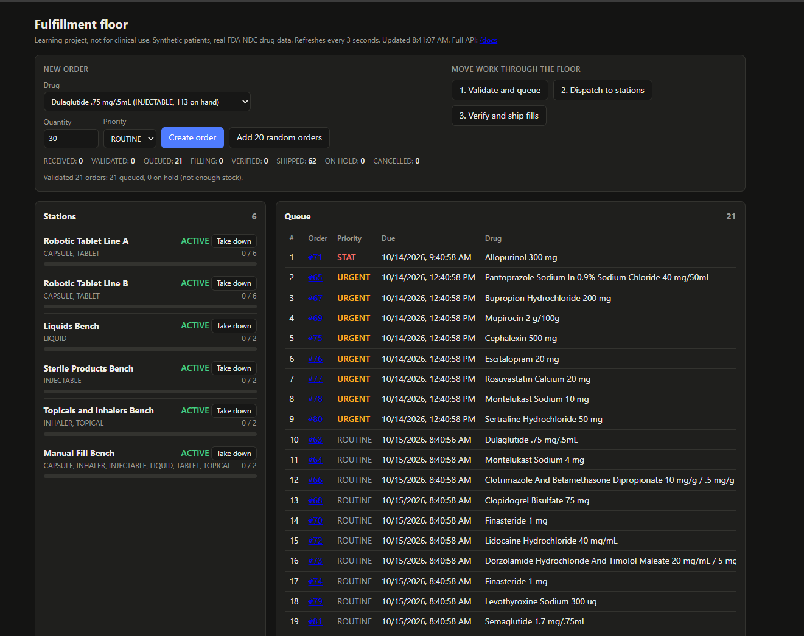
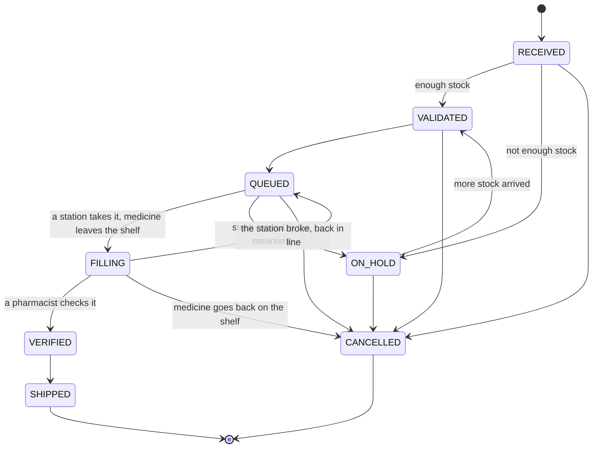
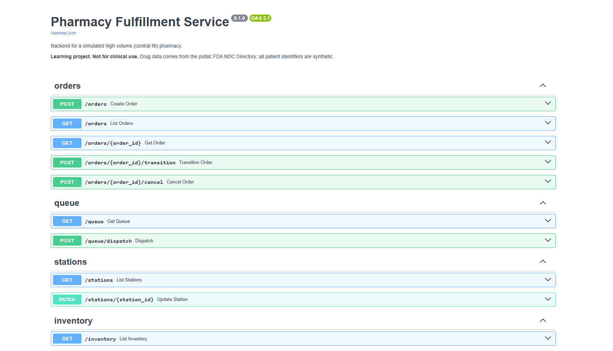
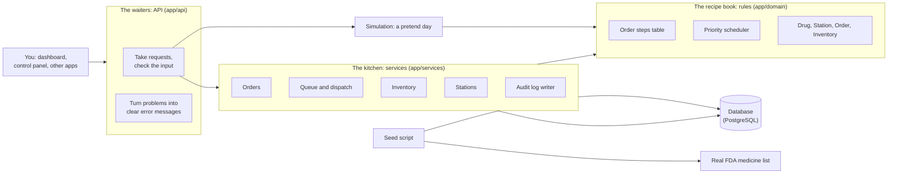

# Pharmacy Order Fulfillment Service

[](https://github.com/Masfiq/pharmacy-fulfillment-service/actions/workflows/ci.yml)


> The medicine list is real (it comes from the U.S. government's FDA database). The patients and
> orders are **made up** by the computer. No real patient data is used anywhere. Never use this
> to make decisions about real medicine.



*The dashboard. On the left, the six filling stations and how busy each one is. On the right,
the waiting line of orders, sorted so the most urgent ones go first. At the top, buttons to create
orders and move them through the pharmacy.*

---

## Contents

- [Pharmacy Order Fulfillment Service](#pharmacy-order-fulfillment-service)
  - [Contents](#contents)
  - [The idea in one minute](#the-idea-in-one-minute)
  - [Words you will see](#words-you-will-see)
  - [The life of one order](#the-life-of-one-order)
  - [Try it yourself: the dashboard](#try-it-yourself-the-dashboard)
  - [The control panel (API docs)](#the-control-panel-api-docs)
  - [How it is built](#how-it-is-built)
  - [The smart parts, explained](#the-smart-parts-explained)
    - [1. The priority line (scheduler)](#1-the-priority-line-scheduler)
    - [2. Never selling the same pill twice](#2-never-selling-the-same-pill-twice)
    - [3. The audit log cannot be skipped](#3-the-audit-log-cannot-be-skipped)
    - [4. Medicine leaves the shelf when filling starts](#4-medicine-leaves-the-shelf-when-filling-starts)
    - [5. Restocking is fair](#5-restocking-is-fair)
    - [6. A pretend day at the pharmacy (simulation)](#6-a-pretend-day-at-the-pharmacy-simulation)
  - [Where the medicine data comes from](#where-the-medicine-data-comes-from)
  - [Real results](#real-results)
  - [How to run it on your computer](#how-to-run-it-on-your-computer)
    - [What the Docker file does, line by line](#what-the-docker-file-does-line-by-line)
  - [Talking to the API from the terminal](#talking-to-the-api-from-the-terminal)
  - [What is in each folder](#what-is-in-each-folder)
  - [Ideas for later](#ideas-for-later)

## The idea in one minute

Some pharmacies are huge. Instead of one pharmacist filling one bottle at a time behind a counter,
a **central fill pharmacy** works like an Amazon warehouse for prescriptions. Thousands of orders
arrive every day. Robots and workstations count pills, fill bottles, and pack boxes, and trucks
ship them out.

To run a place like that, you need software that answers questions like:

- **Which order should we fill next?** An emergency order should not wait behind 500 regular
  refills.
- **Which station can fill it?** A machine that counts tablets cannot fill a bottle of liquid.
- **Do we even have the medicine?** If not, the order has to wait until more arrives.
- **What happened to this order?** Every step must be written down, in case something goes wrong.

This project is that software. It is the "brain" behind the scenes, called a **backend**. You
talk to it through an **API**: a set of web addresses that programs (or you, through the dashboard
or the control panel) can send requests to, like "create an order" or "show me the waiting line".

## Words you will see

| Word | What it means |
| --- | --- |
| **Order** | One prescription to fill: which medicine, how much, for which (made-up) patient. |
| **Priority** | How urgent the order is. **STAT** = emergency (due in 1 hour). **URGENT** = soon (4 hours). **ROUTINE** = normal (24 hours). |
| **Station** | A place where orders are filled, like a pill-counting robot or a bench for liquids. |
| **Capacity** | How many orders a station can work on at the same time. |
| **Dosage form** | The shape of the medicine: tablet, capsule, liquid, injection, cream, inhaler. Each station only handles some forms. |
| **Queue** | The waiting line of orders that are ready to be filled. |
| **Dispatch** | Handing out the next orders from the queue to free stations. |
| **On hold** | The order is waiting because there is not enough medicine in stock. |
| **Audit log** | A diary that records every single step of every order: what changed, when, who did it, and why. |
| **NDC** | National Drug Code. The ID number of a medicine, like a barcode. |
| **API** | A way for programs to ask another program for something and get an answer back. |
| **Database** | Where all the data is saved, organized into tables (like tabs in a spreadsheet). |

## The life of one order

Every order goes on the same journey, one step at a time:



In plain words:

1. **RECEIVED:** the order just arrived.
2. **VALIDATED:** we checked, and there is enough medicine in stock. If there is not, the order
   goes **ON_HOLD** instead.
3. **QUEUED:** the order is waiting in line for a station.
4. **FILLING:** a station is working on it. This is the moment the medicine is taken off the
   shelf.
5. **VERIFIED:** a **pharmacist** checked that the order is correct. Only a pharmacist is allowed
   to do this step; a technician gets a "permission denied" message.
6. **SHIPPED:** done, it is on its way.

Side roads:

- **ON_HOLD:** waiting for more medicine. When new stock arrives, held orders automatically
  go back in line.
- **CANCELLED:** the order was stopped. If it was already being filled, the medicine goes back on
  the shelf.
- **Station breaks:** if a station goes down while filling, its orders go back to the **front**
  of the line and their medicine goes back on the shelf.

**You cannot skip steps or go backwards.** For example, a shipped order can never go back to
filling. If you try, the system refuses with a clear message:
*"Cannot move order from SHIPPED to FILLING"*. All these rules live in one small table in the code
(`app/domain/state_machine.py`), so there is exactly one place that decides what is allowed.

**Every step is written in the audit log.** Open any order and you can see its whole story:

| When | From | To | Who | Why |
| --- | --- | --- | --- | --- |
| 18:45:17 | (new) | RECEIVED | SYSTEM | order received |
| 18:51:17 | RECEIVED | VALIDATED | TECHNICIAN | stock check passed |
| 18:51:17 | VALIDATED | QUEUED | TECHNICIAN | released to fill queue |
| 18:51:29 | QUEUED | FILLING | TECHNICIAN | dispatched to Robotic Tablet Line A |

(Taken from a real run. The reason on the third row was added in a later version; back then it was blank.) In healthcare, being able to trace exactly
what happened is very important, so this is a main feature, not an extra.

## Try it yourself: the dashboard

Once the app is running (see [How to run it](#how-to-run-it-on-your-computer)), open
**http://127.0.0.1:8000/dashboard**. It refreshes every 3 seconds.

**Making orders (top left)**

- **Create order:** pick a medicine (the list shows how many are in stock), a quantity, and a
  priority, then click the button. A made-up patient ID is created for you.
- **Add 20 random orders:** creates 20 orders at once, with a realistic mix: mostly ROUTINE, some
  URGENT, a few STAT.

**Moving orders through the pharmacy (top right).** Click these in order:

1. **Validate and queue:** checks stock for every new order. Orders with enough medicine join the
   queue; the rest go on hold.
2. **Dispatch to stations:** fills every free station slot, most urgent orders first. Watch the
   station bars fill up.
3. **Verify and ship fills:** a pharmacist checks the filled orders and ships them. This frees the
   stations, so you can dispatch again.

**The counters** under the buttons show how many orders are in each step right now.

**Stations (left).** Each one shows what it can fill, how busy it is (like `4 / 6`), and a
**Take down** button. Try taking down a busy station: its orders jump back to the front of the
queue, and you can bring it back with **Bring up**.

**Queue (right).** The waiting line, in the exact order the orders will be filled. Notice that STAT
orders (red) are always at the top, then URGENT, then ROUTINE. Click an order number to see its
full audit log.

## The control panel (API docs)



*Every "door" into the system, listed on one page. Open **http://127.0.0.1:8000/docs**, click any
row, then **Try it out** to send a real request and see the real answer. No coding needed.*

"GET" means "show me something". "POST" means "do something". "PATCH" means "change something".

| Door | What it does |
| --- | --- |
| `POST /orders` | Create a new order |
| `GET /orders` | List orders. You can filter (`?status=QUEUED&priority=STAT`) and get them page by page (`limit`, `offset`) |
| `GET /orders/{id}` | One order, with its full audit log |
| `POST /orders/{id}/transition` | Move an order to its next step |
| `POST /orders/{id}/cancel` | Cancel an order |
| `GET /queue` | The waiting line, most urgent first |
| `POST /queue/dispatch` | Give the next orders to free stations |
| `GET /stations` | All stations and how busy they are |
| `PATCH /stations/{id}` | Take a station down or bring it back up |
| `GET /inventory` | How much of each medicine is in stock |
| `GET /inventory/low-stock` | Medicines that are running low |
| `POST /inventory/{ndc}/restock` | More medicine arrived; held orders get released |
| `POST /simulate` | Run a pretend day at the pharmacy and get a report (see below) |
| `GET /health` | Is everything working? |

When something goes wrong, the answer always has the same shape, so programs can handle it
easily:

```json
{"error": {"code": "invalid_transition",
           "message": "Cannot move order from RECEIVED to SHIPPED",
           "details": {"current_status": "RECEIVED", "requested_status": "SHIPPED"}}}
```

| Error number | Meaning |
| --- | --- |
| 403 | You are not allowed (only a pharmacist can verify) |
| 404 | That order, station, or medicine does not exist |
| 409 | That is not possible right now (wrong step, not enough stock, no free station) |
| 422 | Something in your request is wrong, like a quantity of 0 |
| 503 | The database cannot be reached |

## How it is built

The code is organized in layers, like a restaurant:



- **The waiters (API)** take your request, check that it makes sense, and bring back the answer.
- **The kitchen (services)** does the actual work and talks to the database.
- **The recipe book (rules)** holds the important rules: which steps are allowed, and who goes
  next in line. It never touches the database or the internet. That makes the rules easy to test
  on their own, and the API and the simulation are guaranteed to follow exactly the same rules.

**Tools used:** Python, FastAPI (for the API), PostgreSQL (the database), SQLAlchemy (to talk to
the database from Python), Alembic (to build the database tables step by step), pytest (for the
tests), Docker (to run the database), and GitHub Actions (to run the tests automatically).

## The smart parts, explained

### 1. The priority line (scheduler)

Imagine a hospital emergency room: the most serious patients are seen first, no matter when they
arrived. The queue works the same way. Orders are sorted by:

1. **Priority:** STAT first, then URGENT, then ROUTINE.
2. **Due time:** within the same priority, the one due soonest goes first.
3. **Arrival time:** if those are equal too, first come, first served.

The line is stored in a **heap**, a data structure built for exactly this: it can always hand you
the most important item quickly, without sorting the whole line every time.

When a station is free, the scheduler gives it the most important order **that the station can
handle**. A tablet machine skips liquid orders. If no station can take an order right now, the
order stays in line and does **not** block the orders behind it. If the most urgent order is a
liquid and the liquids bench is busy, tablet orders still keep moving.

How fast is it? (n = orders in line, s = number of stations)

| Action | Speed | In plain words |
| --- | --- | --- |
| Add an order to the line | O(log n) | Even with 1,000,000 orders, only about 20 steps |
| Remove a cancelled order | O(1) | Instant: it is just marked "skip this" |
| Hand out orders to stations | O(k × (log n + s)) | About 20 steps per order handed out, plus a quick look at the 6 stations |
| Show the whole line in order | O(n log n) | Sorting everything once |

Measured for real: with **2,021 orders** waiting, showing the whole line took **44 ms** and
handing out orders to all 20 free station slots took **71 ms** (a blink of an eye is about
100 ms).

### 2. Never selling the same pill twice

What if two orders both want the **last 30 pills** at the same moment? A naive program would
check "are there 30 left? yes!" twice and sell 60 pills that do not exist.

This project takes the pills with **one single database command** that says "remove 30 pills,
but only if there are at least 30". The database handles these commands one at a time for the
same medicine, so the second order sees the shelf is empty and goes **on hold** instead. As a
backup, the database itself refuses to ever store a negative stock number.

This was tested: **20 requests fired at the exact same moment** at stock that covers only 7 of
them. Exactly 7 succeeded, and stock ended at exactly 0.

The same idea protects the stations: two orders cannot both grab the last free slot of a station.
A test fires **12 orders at once at 5 free slots**: exactly 5 get in, and no station goes over its
capacity.

### 3. The audit log cannot be skipped

There is exactly **one** piece of code in the whole project that is allowed to change an order's
step (`app/services/audit.py`). It always writes the audit log entry **in the same database
transaction** as the change. A transaction means "all of these changes happen, or none of them
do". So it is impossible to have a change without a diary entry.

### 4. Medicine leaves the shelf when filling starts

When an order is validated, we only **check** that there is enough medicine. We actually **take**
it when a station starts filling, because that is when it physically leaves the shelf. The
downside: an order can pass the check and then find the shelf empty later, because other orders
got there first. That case is handled: the order goes on hold with the reason
*"insufficient stock at fill time"*.

### 5. Restocking is fair

When new medicine arrives, orders on hold for that medicine are released **most urgent first**,
but only as many as the new stock can actually cover. If 130 pills arrive and three orders each
need 60, the two most urgent go back in line and the third keeps waiting.

### 6. A pretend day at the pharmacy (simulation)

`POST /simulate` creates hundreds or thousands of made-up orders and plays out a whole day,
minute by minute: orders arrive, stations fill them (tablets take 3 minutes, liquids 6, injections
8), pharmacists check them, and sometimes a station breaks down and gets repaired. At the end you
get a report: how many shipped, how long each priority waited, and how busy each station was.

The simulation uses the **same rules** as the real system, but it runs in memory, so it never
touches the real orders in the database. With the same "seed" number it always gives the same
result, which makes experiments repeatable.

## Where the medicine data comes from

The medicines are **real**. The script `scripts/fetch_openfda_drugs.py` downloads them from
**openFDA**, the U.S. Food and Drug Administration's free public database. It picks **129 real
products** of 65 common medicines (like atorvastatin, metformin, lisinopril, insulin glargine, and
amoxicillin) and saves them in `data/drugs_openfda.csv`.

The FDA describes medicine shapes in very detailed ways, like "TABLET, FILM COATED" or
"INJECTION, SOLUTION". The code groups these into six simple types (tablet, capsule, liquid,
injectable, topical, inhaler) so each station knows what it can handle. Controlled substances
(strong painkillers and similar) were left out on purpose.

The patients are **made up** with a tool called Faker. A patient is just an ID like `PT-48213907`.

The pharmacy floor has six stations:

| Station | Can fill | Orders at once |
| --- | --- | ---: |
| Robotic Tablet Line A | tablets, capsules | 6 |
| Robotic Tablet Line B | tablets, capsules | 6 |
| Liquids Bench | liquids | 2 |
| Sterile Products Bench | injections | 2 |
| Topicals and Inhalers Bench | creams, inhalers | 2 |
| Manual Fill Bench | everything | 2 |

## Real results

Every number here comes from actually running the code. Nothing is estimated. They were measured
on one computer (AMD Ryzen 7 7700X, 31 GB RAM, Windows 11, PostgreSQL 16.4), so a different
computer will give different numbers.

**Tests**

- **102 automatic tests, all passing.** Each test is a little robot that checks one thing, like
  "can a shipped order go back to filling?" (it must not) or "can two orders grab the same last
  pills?" (they must not).
- 59 of them test the rules on their own; 43 run against a real database.
- The tests cover **98%** of the code.
- Two more tools check the code style (ruff) and that the code is consistent about data types
  (mypy). Both report no problems.

**Speed test** (`scripts/load_test.py`, sending 2,000 new orders using 16 senders at once):

- All 2,000 succeeded in 6.06 seconds: **about 330 orders per second**.
- Most orders were accepted in 39 ms; 95% in under 108 ms; 99% in under 139 ms.

**A pretend 8-hour day** (`python -m app.cli simulate --orders 2000 --ticks 480 --seed 42`):

| Result | Value |
| --- | --- |
| Orders shipped | 1,759 of 2,000 |
| Orders on hold (medicine ran out) | 232 |
| Average wait before filling started | STAT 0.17 min, URGENT 0.49 min, ROUTINE 3.02 min |
| Average time from arrival to shipping | STAT 4.76 min, URGENT 5.44 min, ROUTINE 7.85 min |
| How busy the stations were overall | 70.7% (busiest: Manual Fill Bench at 95.7%) |
| Station breakdowns / orders sent back to the line | 3 / 8 |
| Audit log entries written | 9,083 |
| Time to run the whole simulation | 154 ms |

**What this shows:** when the pharmacy is busy, emergency (STAT) orders waited about **18 times
less** than normal (ROUTINE) orders. That is the priority line doing its job. The 232 held orders
are medicines that started the day low on stock, which is exactly what the low-stock list is for.

## How to run it on your computer

You need **Python 3.11 or newer** and **Docker Desktop** (for the database).

**Step 1: start the database**

```bash
docker compose up -d
```

**Step 2: set up Python (only the first time)**

```bash
python -m venv .venv
.venv\Scripts\activate              # on Mac or Linux: source .venv/bin/activate
pip install -e ".[dev]"
```

**Step 3: start everything with one command**

```bash
python -m app.cli run
```

This builds the database tables, adds the real medicines, the six stations, and 40 made-up orders
(only the first time), and starts the API. Now open:

- **http://127.0.0.1:8000/dashboard**: the dashboard
- **http://127.0.0.1:8000/docs**: the control panel

**Something not working?**

| What you see | What to do |
| --- | --- |
| Browser says "This site can't be reached" | The app is not running. Run Step 3 again and keep that terminal open. |
| The terminal seems stuck and shows nothing | The database is probably off (this happens after your computer restarts). Start it (Step 1), then run Step 3 again. |
| "only one usage of each socket address is normally permitted" | The app is already running in another terminal. Use that one, or close it first. |

**Other handy commands**

| Command | What it does |
| --- | --- |
| `python -m app.cli seed --reset` | Throw everything away and start fresh (129 medicines, 6 stations, 40 orders) |
| `python -m app.cli simulate` | Run a pretend 8-hour day and print the report |
| `python scripts/fetch_openfda_drugs.py` | Download the latest medicine data from the FDA |
| `python scripts/load_test.py` | Speed test (the app must be running) |
| `pytest --cov` | Run all 102 tests |
| `ruff check . && mypy app tests scripts` | Check code style and data types |

Settings, like where the database is, can be changed with a `.env` file. See `.env.example`.

### What the Docker file does, line by line

`docker-compose.yml` has a comment on every line. In short:

| Line | What it does |
| --- | --- |
| `image: postgres:16` | Download the official PostgreSQL database, version 16. |
| `container_name: pharmacy-db` | Give it a simple name, so `docker logs pharmacy-db` is easy to type. |
| `environment: POSTGRES_USER/PASSWORD/DB` | Create the user and the `pharmacy` database the first time it starts. |
| `ports: "5432:5432"` | Let the app on your computer reach the database. |
| `volumes: pgdata:...` | Save the data on your disk, so it survives when the database is stopped. |
| `./docker/init-test-db.sql:...` | The first time, also create a separate `pharmacy_test` database just for the tests. |
| `healthcheck: pg_isready` | Lets Docker tell you when the database is actually ready. |

## Talking to the API from the terminal

If you prefer typing commands, here are some to copy and paste:

```bash
# Create an emergency (STAT) order for a real medicine: atorvastatin 20 mg tablets
curl -X POST localhost:8000/orders -H "content-type: application/json" \
  -d '{"patient_ref":"PT-12345678","drug_ndc":"50090-7387-0","quantity":30,"priority":"STAT"}'

# Move order 41 to its next step (RECEIVED -> VALIDATED -> QUEUED ...)
curl -X POST localhost:8000/orders/41/transition

# Give the next orders to free stations, most urgent first
curl -X POST localhost:8000/queue/dispatch

# Verifying needs a pharmacist
curl -X POST localhost:8000/orders/41/transition -H "X-Role: PHARMACIST"

# See order 41 and its whole audit log
curl localhost:8000/orders/41

# Only queued STAT orders, 20 per page
curl "localhost:8000/orders?status=QUEUED&priority=STAT&limit=20&offset=0"

# Take station 1 down: its orders go back to the front of the line
curl -X PATCH localhost:8000/stations/1 -H "content-type: application/json" -d '{"status":"DOWN"}'

# What is running low, and restock it
curl localhost:8000/inventory/low-stock
curl -X POST localhost:8000/inventory/50090-7387-0/restock -H "content-type: application/json" -d '{"quantity":500}'

# A pretend 8-hour day with 2,000 orders
curl -X POST localhost:8000/simulate -H "content-type: application/json" -d '{"orders":2000,"ticks":480,"seed":42}'
```

## What is in each folder

```
app/
  domain/          the rules: order steps, the priority line, made-up data generator
  db/              what the database tables look like
  services/        the actual work: orders, queue, inventory, stations, audit log
  api/             the "doors" of the API and the error messages
  simulation.py    the pretend day at the pharmacy
  catalog.py       loads the real medicine list and the station layout
  seed.py, cli.py  fills the database; all the commands
  static/          the dashboard page
alembic/           step-by-step instructions for building the database tables
data/              drugs_openfda.csv (the real FDA medicine data)
img/               the screenshots in this file
scripts/           download the FDA data; speed test
tests/unit/        tests for the rules, no database needed
tests/integration/ tests against a real database
```

## Ideas for later

- **Real logins** for technicians and pharmacists, instead of just saying who you are in the
  request.
- **A robot dispatcher** that hands out orders automatically all day, instead of someone pressing
  the dispatch button.
- **Reserve medicine at validation time**, so fewer orders find an empty shelf when filling starts.
- **Lot numbers and expiration dates**, so the oldest medicine is always used first. (My second
  project, the [Drug Lookup and Inventory API](https://github.com/Masfiq/drug-lookup-inventory-api),
  already does this and uses the same medicine ID numbers, so it could plug right in.)
- **Live charts** of the queue length, waiting times, and how busy each station is.
- **Speed test with several copies of the app** running at once, to see how far it can scale.
