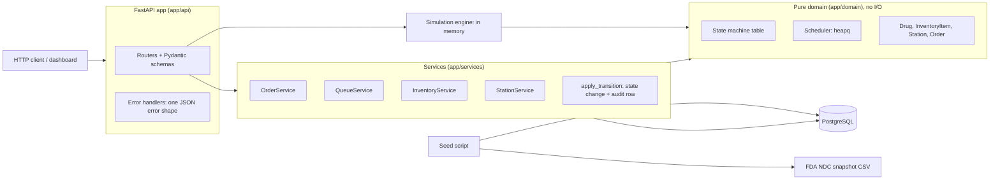
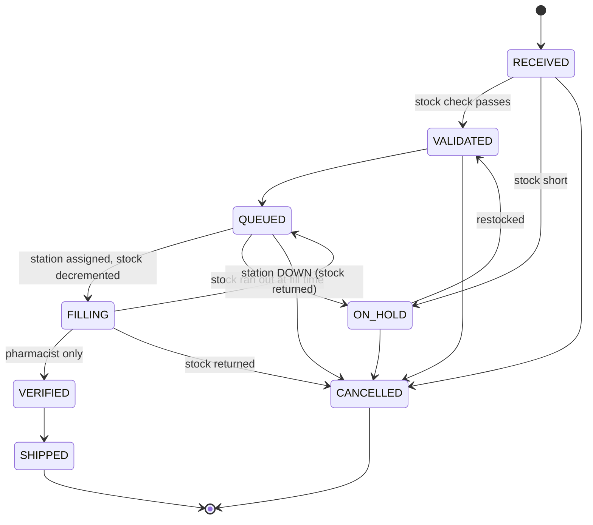

# Pharmacy Order Fulfillment Service

[](https://github.com/Masfiq/pharmacy-fulfillment-service/actions/workflows/ci.yml)

A backend service that simulates a high volume (central fill) pharmacy. It receives prescription
orders, prioritizes them, assigns them to filling stations, tracks inventory, and moves each order
through a strict, audited workflow until it ships.

> **Learning project. Not for clinical use.** The drug catalog is real public data from the
> FDA NDC Directory (openFDA). Every patient identifier and order is synthetic (Faker).
> No real patient data is used anywhere.

**Stack:** Python 3.11+, FastAPI, PostgreSQL 16, SQLAlchemy 2.0, Alembic, Pydantic v2, pytest,
ruff, mypy (strict), Docker Compose, GitHub Actions.

## Contents

- [What it does](#what-it-does)
- [Architecture](#architecture)
- [Order state machine](#order-state-machine)
- [How to run](#how-to-run)
- [Example requests](#example-requests)
- [Design decisions](#design-decisions)
- [Measured results](#measured-results)
- [Project layout](#project-layout)
- [What I would add next](#what-i-would-add-next)

## What it does

- **Orders** move through `RECEIVED → VALIDATED → QUEUED → FILLING → VERIFIED → SHIPPED`, with
  `ON_HOLD` (out of stock) and `CANCELLED` side paths. Invalid moves are rejected with a clear error.
- **Audit log:** every status change is written to `order_audit_log` (from, to, timestamp, reason,
  actor) in the same transaction as the change. `GET /orders/{id}` returns the full trail.
- **Scheduler:** a `heapq` priority queue ordered by `(priority, due_by, created_at)` assigns orders
  to ACTIVE stations that support the drug's dosage form and have free capacity.
- **Stations** can be marked DOWN. Their in-progress orders go back to the front of the queue and
  their stock is returned.
- **Inventory:** validation checks stock (short means ON_HOLD), filling decrements stock with a
  race-safe conditional UPDATE, low stock items have their own endpoint, and a restock releases
  held orders.
- **Roles:** only a `PHARMACIST` (via the `X-Role` header) can verify a fill.
- **Simulation:** generates N synthetic orders, runs the floor for T one-minute ticks, and
  reports throughput, wait times by priority, station utilization, and orders on hold.
- **Dashboard:** `/dashboard` shows the live queue and station load.

### Real drug data

`data/drugs_openfda.csv` holds **129 real products** (NDC, name, strength, dosage form) for
65 commonly dispensed generics, pulled from the openFDA NDC endpoint by
`scripts/fetch_openfda_drugs.py`. FDA dosage forms such as `TABLET, FILM COATED` or
`INJECTION, SOLUTION` are normalized into the station categories TABLET, CAPSULE, LIQUID,
INJECTABLE, TOPICAL, and INHALER (`app/domain/normalize.py`). The CSV is committed, so seeding works
offline; rerun the script to refresh it. Controlled substances were left out on purpose.

## Architecture



The dependency direction only points inward. The domain layer imports nothing from FastAPI or
SQLAlchemy, which keeps the state machine and scheduler easy to unit test.

## Order state machine



The whole workflow is one table, `ALLOWED_TRANSITIONS` in `app/domain/state_machine.py`. Anything
not in the table (for example `SHIPPED → FILLING`) raises `InvalidTransitionError`, which the API
returns as `409` with code `invalid_transition`.

## How to run

You need Python 3.11+ and Docker.

```bash
# 1. Start PostgreSQL (also creates the pharmacy_test database for pytest)
docker compose up -d

# 2. Install
python -m venv .venv
source .venv/bin/activate            # Windows: .venv\Scripts\activate
pip install -e ".[dev]"

# 3. One command: migrate, seed if empty, start the API
python -m app.cli run
```

- API docs (OpenAPI): http://127.0.0.1:8000/docs
- Dashboard: http://127.0.0.1:8000/dashboard

Other commands:

```bash
python -m app.cli seed --reset            # wipe and reseed (129 drugs, 6 stations, 40 orders)
python -m app.cli simulate --orders 2000 --ticks 480
pytest --cov                              # tests against the pharmacy_test database
ruff check . && ruff format --check . && mypy app tests scripts
python scripts/load_test.py --orders 2000 --workers 16   # with the API running
```

Settings come from environment variables or a `.env` file (see `.env.example`):
`DATABASE_URL` and `TEST_DATABASE_URL`.

### The Docker Compose file, line by line

`docker-compose.yml` has a comment on every line. In short:

| Line | Why |
| --- | --- |
| `image: postgres:16` | The official PostgreSQL 16 image. |
| `container_name: pharmacy-db` | A fixed name so `docker logs pharmacy-db` is easy. |
| `environment: POSTGRES_USER/PASSWORD/DB` | The image reads these on first start to create the user and the `pharmacy` database. |
| `ports: "5432:5432"` | Exposes Postgres to the app running on your machine. |
| `volumes: pgdata:/var/lib/postgresql/data` | A named volume, so data survives `docker compose down`. |
| `./docker/init-test-db.sql:/docker-entrypoint-initdb.d/...` | Scripts in that folder run once on first start; ours creates `pharmacy_test`. |
| `healthcheck: pg_isready` | Lets Docker report when Postgres is actually accepting connections. |

## Example requests

```bash
# Create a STAT order for a real NDC (atorvastatin 20 mg tablets)
curl -X POST localhost:8000/orders -H 'content-type: application/json' \
  -d '{"patient_ref":"PT-12345678","drug_ndc":"50090-7387-0","quantity":30,"priority":"STAT"}'

# Move it to its next status (RECEIVED -> VALIDATED -> QUEUED ...)
curl -X POST localhost:8000/orders/41/transition

# Fill the queue in priority order across all free stations
curl -X POST localhost:8000/queue/dispatch

# Only a pharmacist can verify
curl -X POST localhost:8000/orders/41/transition -H 'X-Role: PHARMACIST'

# Detail with full audit history
curl localhost:8000/orders/41

# Filters and pagination
curl 'localhost:8000/orders?status=QUEUED&priority=STAT&limit=20&offset=0'

# Take a station down: its in-progress orders go back to the queue
curl -X PATCH localhost:8000/stations/1 -H 'content-type: application/json' -d '{"status":"DOWN"}'

# Inventory
curl localhost:8000/inventory/low-stock
curl -X POST localhost:8000/inventory/50090-7387-0/restock -H 'content-type: application/json' -d '{"quantity":500}'

# Simulation (in memory, never writes to the database)
curl -X POST localhost:8000/simulate -H 'content-type: application/json' -d '{"orders":2000,"ticks":480,"seed":42}'
```

Every error has the same shape:

```json
{"error": {"code": "invalid_transition",
           "message": "Cannot move order from RECEIVED to SHIPPED",
           "details": {"current_status": "RECEIVED", "requested_status": "SHIPPED"}}}
```

| Status | Codes |
| --- | --- |
| 403 | `permission_denied` (verify without the pharmacist role) |
| 404 | `not_found` |
| 409 | `invalid_transition`, `insufficient_stock`, `no_station_available`, `not_seeded` |
| 422 | `validation_error` |
| 503 | `database_unavailable` |

### Endpoints

| Method | Path | Purpose |
| --- | --- | --- |
| POST | `/orders` | Create an order (RECEIVED) |
| GET | `/orders/{id}` | Detail with audit history |
| GET | `/orders?status=&priority=&limit=&offset=` | List with filters and pagination |
| POST | `/orders/{id}/transition` | Move to the next status, or to `to_status` |
| POST | `/orders/{id}/cancel` | Cancel (returns stock if it was filling) |
| GET | `/queue` | Queued orders in assignment order |
| POST | `/queue/dispatch` | Assign queued orders to stations by priority |
| GET | `/stations` | Stations with current load |
| PATCH | `/stations/{id}` | Mark DOWN or ACTIVE |
| GET | `/inventory` | All stock |
| GET | `/inventory/low-stock` | Items below reorder threshold |
| POST | `/inventory/{ndc}/restock` | Add stock, release held orders |
| POST | `/simulate` | Run the simulation, return the report |
| GET | `/health` | Liveness plus database check |

## Design decisions

### A table driven state machine

All allowed moves live in one dictionary. The API, the services, and the simulation call the same
`ensure_transition`, so the rules cannot drift between code paths, and the table doubles as
documentation. Some steps have system-decided outcomes. For example, asking to validate an order
that is short on stock puts it ON_HOLD instead. The response shows the resulting status, and the
audit row explains why.

### One function changes status, and it always writes the audit row

`app/services/audit.py:apply_transition` is the only code that assigns `order.status`. It checks
the state machine and inserts the `order_audit_log` row in the same transaction, so a status
change without an audit entry cannot happen. The audit table is append-only.

### The scheduler is pure Python, and the database is the source of truth

`Scheduler` (`app/domain/scheduler.py`) holds a `heapq` of `(priority.rank, due_by, created_at,
order_id)` and a map of stations. It does no I/O. For each API call, `QueueService` rebuilds a
scheduler from the current rows, asks it for assignments, and persists them. Rebuilding costs
O(n log n) per call, but the API keeps no in-memory state, so several workers can run side by side
and a restart loses nothing. The simulation instead keeps one scheduler alive across ticks.

**Time complexity** (n = queued orders, s = stations):

| Operation | Cost | Why |
| --- | --- | --- |
| `enqueue` | O(log n) | one `heappush` |
| `remove` (cancel) | O(1) | lazy deletion: the stale heap entry is skipped when popped |
| `assign` | O(k (log n + s)) | k pops at O(log n) each, plus an O(s) scan for a compatible station |
| `snapshot` (`GET /queue`) | O(n log n) | sort of live entries |

An order with no free compatible station is set aside and pushed back afterwards, so one stuck
liquid order never blocks the tablet orders behind it (no head-of-line blocking). The loop stops
as soon as every station is full, so in practice k stays close to the number of free slots
rather than n.

### Preventing inventory race conditions

Stock is decremented with one conditional statement, not "read, check, then write":

```sql
UPDATE inventory_items
   SET quantity_on_hand = quantity_on_hand - :qty
 WHERE drug_ndc = :ndc AND quantity_on_hand >= :qty
RETURNING id;
```

PostgreSQL row-locks the item for the UPDATE. If two transactions race for the last units, the
second one waits, then re-checks the WHERE clause against the committed value, matches zero
rows, and the order goes ON_HOLD. A `CHECK (quantity_on_hand >= 0)` constraint backs this up at
the schema level. `test_concurrent_decrements_never_oversell` fires 20 threads at stock for 7
and asserts exactly 7 succeed.

Other races are handled with row locks taken in a fixed order to avoid deadlocks:
**order row → station rows (all, by id) → inventory row**.

- The order row is locked `FOR UPDATE`, so two requests cannot move the same order at once.
- Station rows are locked `FOR UPDATE` while a slot is chosen, so two requests cannot both take
  the last free slot. `test_concurrent_fills_respect_stock_and_station_capacity` checks this
  with 12 parallel fills against 5 slots.
- Dispatch and restock take queued or held orders with `SKIP LOCKED`, so they never wait on an
  order another request is holding.

### Stock is taken at fill time, not validation time

Validation only checks stock. The decrement happens when filling starts, because that is when
product physically leaves the shelf. The tradeoff is that an order can pass validation and still
find the shelf empty at fill time. That case is handled explicitly (ON_HOLD with reason
`insufficient stock at fill time`) and is tested. When a station goes DOWN or a filling order is
cancelled, its stock is returned.

### Restock releases held orders, but never more than it can fill

A restock walks ON_HOLD orders for that NDC in priority order and releases them (ON_HOLD →
VALIDATED → QUEUED) only while the new stock covers their combined quantity.

### Enums stored as VARCHAR plus CHECK

Statuses and priorities are stored as strings with named CHECK constraints instead of native
PostgreSQL enum types. Adding a value later is a simple migration rather than `ALTER TYPE`, and
the database still rejects unknown values. A test compares the migrated schema with the models
(`compare_metadata`) so a model change without a migration fails CI.

### The simulation runs in memory

`POST /simulate` takes a snapshot of drugs, stock, and stations, then runs entirely on the domain
classes. It reuses the real state machine and scheduler, never touches operational data, and
gives the same report for the same seed (tested). One tick is one minute. Fill times are 2 to 8
ticks depending on dosage form, and stations fail at random (`station_failure_rate`) and come
back after `repair_ticks`.

### Testing against real PostgreSQL

Integration tests run against PostgreSQL, not SQLite, because the behavior under test (row locks,
`SKIP LOCKED`, CHECK constraints, ARRAY columns) is PostgreSQL behavior. The test schema is built
by running the real Alembic migration, and tables are truncated before each test.

## Measured results

All numbers below come from actual runs on the development machine (AMD Ryzen 7 7700X, 16 logical
cores, 31 GB RAM, Windows 11, PostgreSQL 16.4 on localhost, Python 3.13, one uvicorn worker).

**Tests and coverage** (`pytest --cov`):

- **102 tests passing**: 59 unit tests (state machine, scheduler, entities, simulation) and
  43 integration tests against PostgreSQL.
- **98% total coverage** (statements and branches, 1308 statements).
- `ruff check`, `ruff format --check`, and `mypy --strict` all clean.

**Load test** (`scripts/load_test.py --orders 2000 --workers 16`, `POST /orders` only):

- 2000 of 2000 requests succeeded in 6.06 s: **about 330 orders/s**
- Latency p50 / p95 / p99: 39 / 108 / 139 ms

**Dispatch at scale** (live API, 2021 queued orders):

- `GET /queue` returned all 2021 orders in priority order in 44 ms.
- `POST /queue/dispatch` filled all 20 station slots, highest priority first, in 71 ms.

**Simulation** (`python -m app.cli simulate --orders 2000 --ticks 480 --seed 42`, the seeded floor
of 6 stations and 129 drugs, 8 simulated hours):

| Metric | Value |
| --- | --- |
| Orders shipped | 1759 of 2000 |
| Orders on hold (stock ran out) | 232 |
| Average wait to start filling | STAT 0.17 min, URGENT 0.49 min, ROUTINE 3.02 min |
| Average arrival to ship | STAT 4.76 min, URGENT 5.44 min, ROUTINE 7.85 min |
| Overall station utilization | 70.7% (busiest: Manual Fill Bench 95.7%) |
| Station failures / orders requeued | 3 / 8 |
| Audit records written | 9083 |
| Run time | 154 ms |

These numbers show the scheduler working under load: STAT orders waited about 18 times less than
ROUTINE orders. The 232 held orders come from items seeded below their reorder threshold, which is
what `/inventory/low-stock` is for.

## Project layout

```
app/
  domain/          pure Python: enums, errors, state machine, scheduler, entities, synthetic data
  db/              SQLAlchemy models and session
  services/        use cases: orders, queue/dispatch, inventory, stations, audit
  api/             FastAPI routers, dependencies, error handlers
  simulation.py    in-memory discrete time simulation
  catalog.py       loads the FDA NDC snapshot and the station layout
  seed.py, cli.py  seeding and the command line entry point
  static/          dashboard page
alembic/           migrations
data/              drugs_openfda.csv (real FDA NDC data)
scripts/           fetch_openfda_drugs.py, load_test.py
tests/unit/        no database needed
tests/integration/ PostgreSQL test database
```

## What I would add next

- Authentication (OAuth2 or JWT) instead of a trusted `X-Role` header.
- A background worker that dispatches continuously and moves fills to VERIFIED, instead of
  manual `POST /queue/dispatch` calls.
- Stock reservation at validation time, so fewer orders discover an empty shelf at fill time.
- Lot numbers and expiration dates on inventory, and FEFO (first expiring, first out) picking.
- Metrics (Prometheus) for queue depth, wait time by priority, and station utilization.
- Run the load test against several uvicorn workers and inside Docker to measure scaling.
